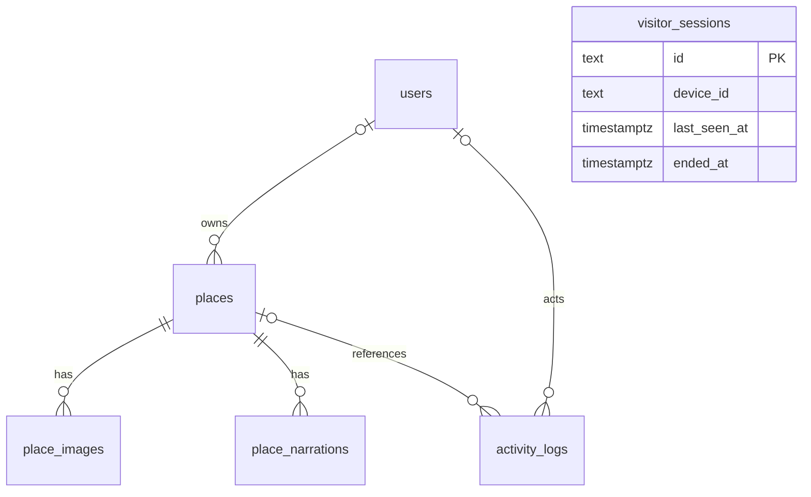

# Thiết kế 6 bảng cho demo SmartTour Guide

**Thiết kế được chốt ngày 29/10/2026: giữ đúng 6 bảng.** Không chạy file 004
(phương án 15 bảng đã hủy). Xem `PRD-6-TABLES-UPDATE.md` để cập nhật phần dữ liệu
trong báo cáo và phân biệt phần đã có với phần chưa ánh xạ.

Schema đích: `smarttour_demo`. File tạo bảng: `database/postgres/002_smarttour_compact.sql`.
Backend hiện có adapter `PostgresPlatformStore` và `PostgresStateCodec` dùng schema này.
SQLite vẫn là mặc định khi không chọn Postgres. Xem [bộ kiểm tra hiện tại](../database/supabase-review/README.md);
không suy ra trạng thái database online từ tài liệu thiết kế.

Bản rút gọn có **44 cột**, mỗi bảng tối đa **8 cột**:
users 7, places 8, place_images 7, place_narrations 8, visitor_sessions 6,
activity_logs 8. Bản tiếng Việt được lưu tại place_narrations với mã `vi`.

Các cột JSONB chứa thông tin phụ, không thay thế khóa chính/khóa ngoại:

| Cột | Nội dung thiết kế ban đầu (tên key thực tế xem codec) |
|---|---|
| users.settings | verified, must_change_password, security_stamp, created_at |
| places.settings | category, region, is_active, is_demo, nguồn thông tin, xác minh tọa độ, bán kính, ưu tiên audio, updated_at |
| place_images.metadata | credit, source_url, focus_y |
| place_narrations.metadata | source_hash, published_revision, updated_by, updated_at, audio_sha256, audio_bytes, voice, provider |
| visitor_sessions.device_info | browser, operating_system, device_type |
| activity_logs.details | language_code, action, resource |

Đây là đánh đổi để bảng ngắn: các thuộc tính trong JSONB không có ràng buộc
kiểu dữ liệu hay khóa ngoại riêng; Backend phải kiểm tra cấu trúc, giá trị, quyền
truy cập và tính nhất quán khi đọc/ghi. Adapter đã có kiểm thử round-trip và PostgreSQL riêng; chưa thay thế kiểm thử toàn bộ giao diện/UC online.

| Bảng | Chức năng |
|---|---|
| users | Tài khoản, mật khẩu băm, vai trò và trạng thái |
| places | Địa điểm, địa chỉ, tọa độ, giới thiệu và thuyết minh tiếng Việt |
| place_images | Nhiều ảnh, ảnh bìa, chú thích và nguồn |
| place_narrations | Nội dung theo ngôn ngữ/phiên bản, trạng thái duyệt và thông tin MP3 |
| visitor_sessions | Phiên từng tab và thông tin phân loại trình duyệt/thiết bị |
| activity_logs | Lượt xem/nghe có đồng ý thống kê và nhật ký quản trị |



`visitor_sessions` độc lập vì khách không phải đăng nhập. Một trình duyệt có nhiều tab;
không tính mỗi tab là một thiết bị. Truy vấn số thiết bị hoạt động:

```sql
SELECT count(DISTINCT device_id) AS active_devices
FROM smarttour_demo.visitor_sessions
WHERE ended_at IS NULL
  AND last_seen_at > now() - interval '45 seconds';
```

Backend hiện dùng `PresenceService` để xử lý heartbeat, leave và heartbeat đến trễ;
codec ánh xạ phiên đang lưu sang `visitor_sessions`. Query trên không tự làm
những việc đó. Mất mạng/đóng cưỡng bức có thể mất tối đa 45 giây để giảm số đếm.

## Phạm vi và giới hạn

- Gộp bản dịch và metadata âm thanh vào `place_narrations`, một audio cho mỗi phiên bản.
  Đổi nội dung/giọng cần tạo phiên bản hoặc cập nhật metadata theo quy tắc Backend.
- Vai trò cơ bản nằm trong `users.role`. Các collection phụ như roles, menu, refresh
  session, thông báo, audio task, quota và runtime state được codec lưu trong envelope
  `activity_logs.details.state`, tại ID dành riêng `system:platform-state:v1`.
  Đây là persistence JSONB có kiểu trong code, chưa phải bảng quan hệ riêng theo từng UC.
  Không hiển thị/export envelope như log quản trị hay analytics; có thể chứa trạng thái bí mật.
- Không lưu mật khẩu rõ hoặc MP3 nhị phân vào SQL. Tọa độ `places` là của địa điểm.
  Presence không lưu GPS khách; tính năng runtime sharing riêng có thể nằm trong envelope
  theo lựa chọn đồng ý của khách và quy tắc lưu giữ của backend.
- Chỉ Backend truy cập bảng. Chưa cấp quyền cho Data API trình duyệt.

## Áp dụng an toàn

Script tạo namespace mới, không DROP/xóa/gộp 27 bảng đã tạo trong `smarttour`.
Chọn `smarttour_demo` trong Schema Visualizer để xem riêng đúng 6 bảng.
Không chạy lại file 001 để tạo bản rút gọn. Báo cáo ngày 15/11/2026 trong
`HUONG-DAN-XEM-SUPABASE.md` đã ghi nhận import/kết nối; đó không phải xác nhận online mới.
Chỉ dọn schema cũ sau khi kiểm tra dữ liệu, sao lưu và xác nhận nó không còn được dùng.
Nếu đã chạy bản 002 trước khi rút gọn cột, bản mới sẽ báo lỗi và rollback để tránh
hiểu nhầm rằng CREATE TABLE IF NOT EXISTS đã sửa bảng cũ. Cần migration có sao lưu;
không tự DROP schema đang có dữ liệu.

File chuyển đổi tại chỗ: `database/postgres/003_compact_existing_tables.sql`.
Xuất backup trên Supabase trước nếu đã nhập dữ liệu quan trọng. Script giữ nguyên
bản ghi/ID và các cột chính, gom giá trị cột bị bỏ vào JSONB trong cùng transaction.
Không dùng CASCADE; phụ thuộc ngoài dự kiến sẽ gây rollback. Nội dung tiếng Việt
cũ ở places.narration_vi được giữ tại places.settings.narration_vi; cần adapter
chuyển nó sang hàng ngôn ngữ vi khi nhập vào mô hình mới. Chưa kiểm thử chuyển đổi
trực tiếp trên Supabase. Các ràng buộc của cột đã gom cần Backend thay thế bằng
validation; việc chạy script không làm website tự dùng Supabase.
