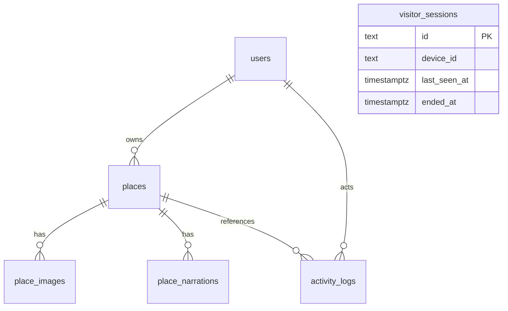

# Thiết kế 6 bảng cho demo SmartTour Guide

**Thiết kế được chốt ngày 29/10/2026: giữ đúng 6 bảng.** Không chạy file 004
(phương án 15 bảng đã hủy). Xem `PRD-6-TABLES-UPDATE.md` để cập nhật phần dữ liệu
trong báo cáo và phân biệt phần đã có với phần chưa ánh xạ.

Schema đích: `smarttour_demo`. File tạo bảng: `database/postgres/002_smarttour_compact.sql`.
Đây là thiết kế cho chức năng cốt lõi; chưa phải bản chuyển đổi Backend đang chạy.

Bản rút gọn có **44 cột**, mỗi bảng tối đa **8 cột**:
users 7, places 8, place_images 7, place_narrations 8, visitor_sessions 6,
activity_logs 8. Bản tiếng Việt được lưu tại place_narrations với mã `vi`.

Các cột JSONB chứa thông tin phụ, không thay thế khóa chính/khóa ngoại:

| Cột | Nội dung dự kiến khi viết adapter |
|---|---|
| users.settings | verified, must_change_password, security_stamp, created_at |
| places.settings | category, region, is_active, is_demo, nguồn thông tin, xác minh tọa độ, bán kính, ưu tiên audio, updated_at |
| place_images.metadata | credit, source_url, focus_y |
| place_narrations.metadata | source_hash, published_revision, updated_by, updated_at, audio_sha256, audio_bytes, voice, provider |
| visitor_sessions.device_info | browser, operating_system, device_type |
| activity_logs.details | language_code, action, resource |

Đây là đánh đổi để bảng ngắn: các thuộc tính trong JSONB không có ràng buộc
kiểu dữ liệu hay khóa ngoại riêng; Backend phải kiểm tra cấu trúc, giá trị, quyền
truy cập và tính nhất quán khi đọc/ghi. Chưa có adapter thực hiện kiểm tra này.

| Bảng | Chức năng |
|---|---|
| users | Tài khoản, mật khẩu băm, vai trò và trạng thái |
| places | Địa điểm, địa chỉ, tọa độ, giới thiệu và thuyết minh tiếng Việt |
| place_images | Nhiều ảnh, ảnh bìa, chú thích và nguồn |
| place_narrations | Nội dung theo ngôn ngữ/phiên bản, trạng thái duyệt và thông tin MP3 |
| visitor_sessions | Phiên từng tab và thông tin phân loại trình duyệt/thiết bị |
| activity_logs | Lượt xem/nghe có đồng ý thống kê và nhật ký quản trị |



`visitor_sessions` độc lập vì khách không phải đăng nhập. Một trình duyệt có nhiều tab;
không tính mỗi tab là một thiết bị. Truy vấn số thiết bị hoạt động:

```sql
SELECT count(DISTINCT device_id) AS active_devices
FROM smarttour_demo.visitor_sessions
WHERE ended_at IS NULL
  AND last_seen_at >= now() - interval '45 seconds';
```

Backend tương lai phải cập nhật heartbeat, kết thúc phiên khi rời trang, xử lý heartbeat
đến muộn sau khi đóng tab và từ chối tái mở phiên đã kết thúc. Query trên không tự làm
những việc đó. Mất mạng/đóng cưỡng bức có thể mất tối đa 45 giây để giảm số đếm.

## Phạm vi và giới hạn

- Gộp bản dịch và metadata âm thanh vào `place_narrations`, một audio cho mỗi phiên bản.
  Đổi nội dung/giọng cần tạo phiên bản hoặc cập nhật metadata theo quy tắc Backend.
- Vai trò lưu trong `users.role`. Phân quyền tùy chỉnh hiện có chưa được ánh xạ sang
  mô hình này; không tự bỏ chức năng quản lý quyền của website.
- Các phần phụ hiện có như duyệt hồ sơ chủ quán, thực đơn, thông báo, refresh token,
  hàng đợi TTS và quota chưa có nơi lưu trong 6 bảng này. Cần chốt lưu trữ/mapping
  trước khi chuyển toàn bộ hệ thống. Không được coi schema này đã thay thế toàn bộ SQLite.
- Không lưu mật khẩu rõ, MP3 nhị phân, IP/MAC hay GPS của khách vào các bảng này.
  Tọa độ trong `places` là tọa độ địa điểm để tính khoảng cách trên trình duyệt.
- Chỉ Backend truy cập bảng. Chưa cấp quyền cho Data API trình duyệt.

## Áp dụng an toàn

Script tạo namespace mới, không DROP/xóa/gộp 27 bảng đã tạo trong `smarttour`.
Chọn `smarttour_demo` trong Schema Visualizer để xem riêng đúng 6 bảng.
Không chạy lại file 001 để tạo bản rút gọn. Chưa nhập dữ liệu và chưa chuyển provider API.
Chỉ dọn schema cũ sau khi kiểm tra dữ liệu, sao lưu và xác nhận nó không còn được dùng.
Nếu đã chạy bản 002 trước khi rút gọn cột, bản mới sẽ báo lỗi và rollback để tránh
hiểu nhầm rằng CREATE TABLE IF NOT EXISTS đã sửa bảng cũ. Cần migration có sao lưu;
không tự DROP schema đang có dữ liệu.

File chuyển đổi tại chỗ: `database/postgres/003_compact_existing_tables.sql`.
Xuất backup trên Supabase trước nếu đã nhập dữ liệu quan trọng. Script giữ nguyên
bản ghi/ID và các cột chính, gom giá trị cột bị bỏ vào JSONB trong cùng transaction.
Không dùng CASCADE; phụ thuộc ngoài dự kiến sẽ gây rollback. Nội dung tiếng Việt
cũ ở places.narration_vi được giữ tại places.settings.narration_vi; cần adapter
chuyển nó sang hàng ngôn ngữ vi khi nhập vào mô hình mới. Chưa kiểm thử chuyển đổi
trực tiếp trên Supabase. Các ràng buộc của cột đã gom cần Backend thay thế bằng
validation; việc chạy script không làm website tự dùng Supabase.
