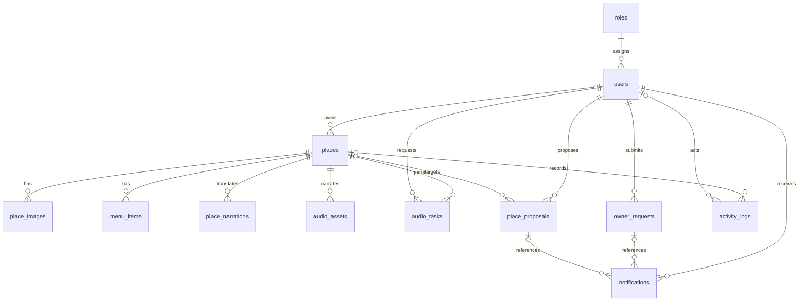

# Đối chiếu database với PRD SmartTour Guide

> Phương án 15 bảng bên dưới đã hủy theo lựa chọn cuối của người dùng.
> Không chạy file 004. Thiết kế hiện được chốt là 6 bảng; xem
> `DATABASE-6-TABLES.md` và `PRD-6-TABLES-UPDATE.md`.

Ngày đối chiếu: 29/10/2026.
Nguồn: `C:/Users/Admin/Downloads/PRD_SMARTTOUR_GUIDE (2).pdf`, phiên bản tổng hợp
1.0 ngày 22/10/2026, mục I.9 (trang 11), VI.2–VI.8 (trang 142–148).

## Quyết định thiết kế

PRD mô tả **thực thể logic**, không quy định bắt buộc 6, 15 hay 27 bảng.
PRD còn ghi rõ lúc soạn tài liệu hệ thống dùng JSON, ERD không phải SQL đã triển khai.
Thiết kế này ánh xạ các thực thể đó sang SQL, giữ vai trò, hồ sơ, thông báo, bản dịch,
audio và nhật ký ở các bảng riêng; không gom mọi chức năng vào JSONB để giảm số cột.

File áp dụng: `database/postgres/004_align_demo_with_prd.sql`.
Schema: **smarttour_demo**, tổng **15 bảng** sau khi nâng cấp từ bản 6 bảng.
Không tạo schema mới, không xóa bản ghi, không đổi mật khẩu hay thay provider API.

## Bảng và truy vết

| Thực thể PRD | Bảng SQL | UC / chức năng |
|---|---|---|
| PlatformRole / Role | roles | UC21: quyền nằm trong permissions[], vai trò hệ thống |
| PlatformUser / User | users | UC11–13, UC20: tài khoản, role FK, trạng thái xác minh, security stamp |
| Place | places | UC01–03, UC08, UC17: POI, nguồn Việt, địa chỉ, tọa độ, chủ sở hữu |
| PlacePhoto | place_images | UC02, UC18: ảnh, nguồn, credit, license, crop, thứ tự, ảnh bìa |
| TranslationReview / TranslationDraft | place_narrations | UC04–05, UC22: ngôn ngữ, sourceHash, phiên bản, trạng thái công bố |
| MenuItem | menu_items | UC19: thực đơn theo POI, giá số/giá hiển thị |
| OwnerRequest / OwnerReview đăng ký | owner_requests | UC13, UC15: đăng ký, gửi lại, lịch sử quyết định |
| PlaceProposal / OwnerReview đề xuất | place_proposals | UC14–15: đề xuất tạo/sửa, payload chờ duyệt, version POI |
| OwnerNotification / Notification | notifications | UC16: người nhận, hồ sơ/đề xuất liên quan, đã đọc |
| AudioAsset | audio_assets | UC05, UC22: metadata MP3 theo POI/ngôn ngữ/hash/revision |
| AudioTask | audio_tasks | UC23: hàng đợi, tiến độ, pause/resume/cancel, lỗi |
| AuditLog | audit_logs | UC25: người thực hiện, hành động, tài nguyên, thời gian |
| AnalyticsEvent | activity_logs | UC09, UC24: sự kiện view/play có consent, không có GPS |
| RuntimeSession | runtime_sessions | UC10, UC27: consent độc lập, tọa độ làm tròn, thời hạn <=24h |
| Phiên thiết bị online (bổ sung sau PRD) | visitor_sessions | Admin xem trình duyệt đang hoạt động; độc lập analytics/runtime |

`OwnerRequest` và `PlaceProposal` được tách bảng theo từ điển mở rộng trang 147.
Code C# hiện gộp hai loại trong Review; adapter tương lai cần phân loại `kind` khi nhập.
`TranslationDraft` và bản công bố là các trạng thái/phiên bản trong place_narrations;
không coi draft là published. Nội dung tiếng Việt chuẩn nằm ở places.description_vi.

## Quan hệ chính

Audit actor giữ ID dạng text để bảo toàn dấu vết ngay cả khi tài khoản không còn.
visitor_sessions và runtime_sessions độc lập; khách không cần đăng nhập.
Không ghép GPS vào analytics hoặc mặc định tất cả thiết bị đã đồng ý giám sát.

## Những ràng buộc đã có trong SQL

- FK user–role, owner–POI và các tài nguyên con–POI; notification–người nhận/hồ sơ.
- Một ảnh bìa mỗi POI; thứ tự ảnh không trùng trong POI.
- Một bản approved mỗi POI/ngôn ngữ; version không trùng trong POI/ngôn ngữ.
- Một đăng ký pending mỗi user; một đề xuất sửa pending mỗi POI.
- Một audio task queued/running/paused mỗi POI.
- Ràng buộc tọa độ, ngôn ngữ, số lượng tiến độ và thời hạn runtime tối đa 24 giờ.
- Sự kiện view/play cần consent và device_id; RLS bật cho cả 15 bảng, PUBLIC không có quyền.

## Backend vẫn phải thực hiện, không thể kết luận chỉ từ sơ đồ

- Import và xác thực dữ liệu; giữ password hash/security stamp; nhập đúng permissions
  từ PlatformRole. Script chỉ giữ tên role hiện có, không tự cấp quyền.
- Các cột backfill thiếu nguồn thật để NULL; không tạo hash, license hoặc nội dung giả.
  Phải kiểm tra đủ dữ liệu trước công bố POI hoặc phát audio.
- Kiểm tra sourceHash/revision giữa places, bản dịch và audio; tạo MP3 thành công mới
  công bố atomically. Metadata audio cũ trong JSON/audio_path vẫn giữ nguyên, chưa tự
  nhập thành audio_assets khi thiếu thông tin bắt buộc.
- Bảo vệ role hệ thống, chống nâng quyền, ownership, CSRF, giới hạn gallery, xác minh
  chủ quán, masking/encryption dữ liệu giấy tờ và thông báo đúng người nhận.
- Không tái sử dụng ID POI đã xóa; xóa/ẩn POI phải có chính sách lưu lịch sử phù hợp.
  FK các bảng mới dùng RESTRICT mặc định để không âm thầm mất hồ sơ/nhật ký.
- Retention, xóa runtime hết hạn, thu hồi consent và từ chối request trễ cần worker/logic.
  CHECK thời hạn không tự xóa bản ghi sau 24 giờ.
- visitor_sessions cần heartbeat/leave, chống heartbeat đến muộn và đếm DISTINCT device_id
  còn hoạt động trong 45 giây. Chưa phải nhận diện máy vật lý/MAC.

## Dữ liệu ngoài các bảng nghiệp vụ PRD

Theo VI.5/VI.8, OfflinePackClient ở IndexedDB của thiết bị, MP3 và PMTiles ở kho file.
UC06–07 không cần tạo bảng gói offline giả ở server. Không thêm bảng “AI weather”.
Phiên refresh token, ciphertext giấy tờ, tombstone, quota và hàng đợi/revocation nội bộ
của source hiện tại vẫn cần thiết kế lưu trữ khi viết adapter PostgreSQL; bộ 15 bảng
nghiệp vụ này chưa thay thế toàn bộ IPlatformStore. UC12/26/28 còn phụ thuộc các phần đó.

## Thứ tự chạy và trạng thái kiểm thử

1. Với schema 6 bảng đã rút gọn trong ảnh: chỉ chạy **004_align_demo_with_prd.sql**.
2. Không chạy lại 003 sau khi đã nâng cấp 004.
3. Refresh Schema Visualizer, chọn smarttour_demo, kiểm tra kết quả 15 bảng.
4. Sau đó mới triển khai adapter C#, backup/import SQLite và kiểm thử tích hợp.

Đã thử SQL 002 → 004 trên PostgreSQL 17 Docker tạm, kiểm tra 15 bảng/16 FK,
backfill user/POI/ảnh từ JSONB, chạy lại 004 giữ giá trị đã chỉnh, RLS,
role FK, chống pending đăng ký trùng và giới hạn thời hạn runtime. Tất cả đạt.
Container thử nghiệm đã dừng/xóa, không dùng volume demo.

Chưa chạy 004 trên Supabase, chưa import dữ liệu thật, chưa viết adapter PostgreSQL,
chưa kiểm thử lại toàn bộ 28 UC bằng PostgreSQL. Không đánh dấu hệ thống đã hoàn thành
chuyển đổi chỉ vì tạo được bảng. PRD phải cập nhật phần mô tả JSON cũ nếu nộp kèm SQL mới.
