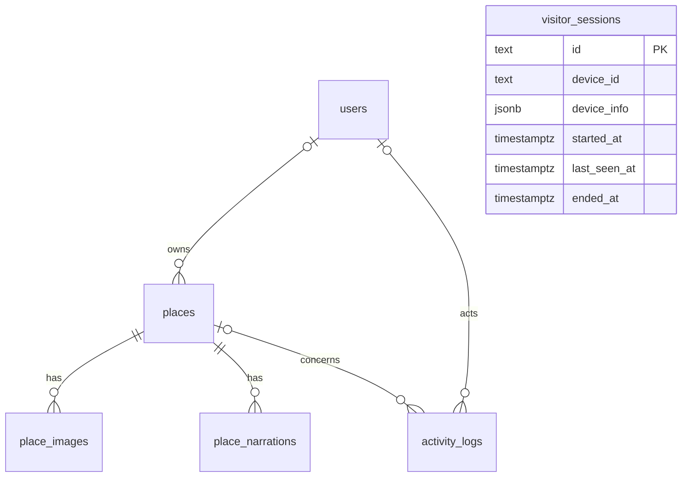

# Nội dung cập nhật PRD — thiết kế 6 bảng

Ngày cập nhật: 29/10/2026. Dùng để thay phần thiết kế dữ liệu của PRD 22/10/2026;
không phải bằng chứng đã chạy toàn bộ UC trên PostgreSQL.

## Đoạn thay cho phần I.9 và phần giới thiệu VI

SmartTour Guide lựa chọn mô hình dữ liệu gồm 6 bảng nghiệp vụ chính trong schema
`smarttour_demo`: users, places, place_images, place_narrations, visitor_sessions
và activity_logs. Các định danh và quan hệ chính dùng cột SQL cùng khóa chính/khóa
ngoại. Thông tin phụ được lưu trong JSONB để giảm số cột; Backend phải xác thực
cấu trúc và tính nhất quán của các trường JSONB.

Thiết kế SQL này là mô hình đích cho chức năng khám phá địa điểm, thuyết minh,
quản lý tài khoản cơ bản và thống kê. Không đồng nhất 6 bảng vật lý với toàn bộ
thực thể logic của 28 Use Case. Các thực thể phụ trong bản PRD cũ vẫn là yêu cầu
nghiệp vụ và chưa có mapping PostgreSQL hoàn chỉnh; không được tự bỏ UC vì giảm bảng.

Ứng dụng hiện vận hành bằng SQLite. Theo ảnh Schema Visualizer người dùng cung cấp,
6 bảng đã được tạo trên Supabase; chưa kết nối Backend PostgreSQL và chưa kiểm
chứng dữ liệu thật trên Supabase. Tạo bảng thành công không đồng nghĩa chuyển đổi
database đã hoàn tất.

## VI.1. Danh mục bảng và trường dữ liệu

| Bảng | Cột | Vai trò |
|---|---|---|
| users | id, username, display_name, password_hash, role, enabled, settings | Tài khoản và vai trò cơ bản |
| places | id, owner_id, name, address, latitude, longitude, introduction, settings | Địa điểm và dữ liệu giới thiệu |
| place_images | id, place_id, url, caption, ordinal, is_cover, metadata | Bộ ảnh và ảnh bìa |
| place_narrations | id, place_id, language_code, narration_text, audio_path, status, version, metadata | Nội dung đa ngôn ngữ và MP3 tương ứng |
| visitor_sessions | id, device_id, device_info, started_at, last_seen_at, ended_at | Phiên từng tab, đếm trình duyệt đang hoạt động |
| activity_logs | id, kind, user_id, device_id, place_id, consent, details, created_at | Lượt xem/nghe và nhật ký quản trị |

Tổng: 6 bảng, 44 cột; mỗi bảng 6–8 cột.

## VI.2. Quan hệ giữa các bảng

Khách không phải đăng nhập nên visitor_sessions độc lập với users. Mã device_id
nhận diện trình duyệt ẩn danh, không phải tên máy, MAC hoặc định danh phần cứng.
Một trình duyệt có nhiều tab nhưng được tính một lần bằng DISTINCT device_id.

## VI.3. Thuộc tính mở rộng JSONB

| Cột | Thuộc tính dự kiến |
|---|---|
| users.settings | verified, must_change_password, security_stamp, created_at |
| places.settings | category, region, is_demo, is_active, location_verified, source_url, address_source_url, location_source_url, trigger_radius, audio_priority, updated_at |
| place_images.metadata | credit, source_url, license khi có nguồn xác thực, focus_y |
| place_narrations.metadata | source_hash, published_revision, updated_by, updated_at, audio_sha256, audio_bytes, voice, provider |
| visitor_sessions.device_info | browser, operating_system, device_type |
| activity_logs.details | language_code, action, resource |

Tiếng Việt dùng language_code='vi'. Các ngôn ngữ còn lại là en, zh, ja, ko, fr.
Một hàng narration chứa nội dung và đường dẫn audio của một phiên bản. Không lưu
MP3 nhị phân vào SQL. Nội dung Việt cũ còn trong places.settings.narration_vi sau
chuyển đổi 003 phải được ánh xạ sang hàng vi khi nhập dữ liệu.

## VI.4. Quy tắc toàn vẹn và quyền riêng tư

- username duy nhất; mật khẩu lưu dưới dạng hash, không gửi hash ra Frontend.
- Ảnh và narration thuộc POI thông qua FK; thứ tự ảnh không trùng, tối đa một ảnh bìa.
- Một bản approved mỗi POI/ngôn ngữ; các phiên bản khác có thể là draft hoặc archived.
- Backend phải đối chiếu source_hash/version trước khi dùng bản dịch hoặc phát audio.
- JSONB không có FK hay kiểm tra kiểu từng thuộc tính; validation là trách nhiệm Backend.
- Chỉ thu thập lượt xem/nghe khi có consent. Presence hoạt động tách khỏi consent analytics.
- Presence chỉ tính phiên chưa kết thúc và có last_seen_at trong 45 giây; phải xử lý
  đóng tab, heartbeat trễ và nhiều tab ở Backend, không chỉ viết câu query đếm.
- Gợi ý khoảng cách dùng tọa độ địa điểm và GPS được trình duyệt cấp quyền. Sáu bảng
  này không chứa lịch sử GPS khách. Chia sẻ vị trí giám sát là tính năng khác.
- OfflinePackClient dùng IndexedDB; audio và PMTiles dùng kho file, không tạo thêm bảng.

## VI.5. Các yêu cầu PRD chưa được ánh xạ đầy đủ

| Yêu cầu/UC | Giới hạn của thiết kế 6 bảng |
|---|---|
| UC11–12: phiên đăng nhập, đổi mật khẩu | settings giữ security_stamp; chưa thiết kế nơi lưu refresh session trên PostgreSQL |
| UC13–16: đăng ký, đề xuất, duyệt, thông báo | Chưa có mapping hồ sơ/đề xuất/thông báo có trạng thái và người nhận |
| UC19: thực đơn | Chưa có mapping MenuItem |
| UC21: vai trò tùy chỉnh | users.role chỉ lưu tên; chưa có mapping danh mục role/permissions dùng chung |
| UC23: tác vụ audio | audio_path không thay thế hàng đợi task/progress/pause/resume/cancel |
| UC26: giấy tờ tùy chọn | Chưa có mapping ciphertext và thời hạn |
| UC10/27: giám sát vị trí được đồng ý | Không lưu vào presence/analytics; chưa có mapping runtime và revocation riêng |

Những chức năng này vẫn có trong code hiện tại và kho SQLite. Chưa được coi là
đã chuyển sang Supabase. Cần thống nhất cấu trúc lưu trữ trước khi đổi provider;
không giấu thiếu sót bằng cách ghi tất cả đã nằm trong JSONB.

## Nội dung cần cập nhật ở các phần khác của PRD

1. Thay các ERD cũ tại VI.1/VI.3/VI.4 bằng sơ đồ vật lý 6 bảng và bảng giới hạn phía trên;
   có thể giữ sơ đồ cũ nếu ghi rõ đó là mô hình logic nghiệp vụ.
2. Sửa phần kiến trúc triển khai: hiện tại SQLite, PostgreSQL/Supabase là đích chuyển đổi.
3. Giữ danh sách 28 UC, cập nhật trạng thái lưu trữ theo từng UC; không ghi tất cả đạt.
4. Phân biệt kiểm thử cấu trúc SQL với kiểm thử đầy đủ chức năng Frontend/Backend.

File này là nội dung thay thế dạng Markdown để nhóm đưa vào bản Word/PDF gốc.
Không chỉnh sửa hoặc ghi đè PDF trong Downloads.
