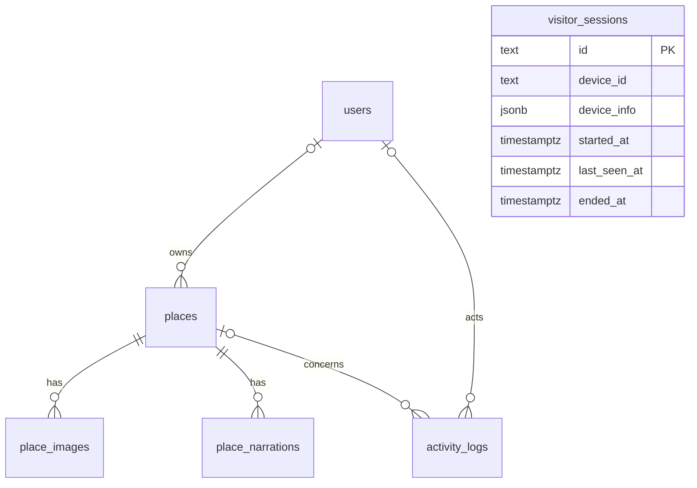

# Nội dung cập nhật PRD — thiết kế 6 bảng

Ngày cập nhật: 29/10/2026. Dùng để thay phần thiết kế dữ liệu của PRD 22/10/2026;
không phải bằng chứng đã chạy toàn bộ UC trên PostgreSQL.

## Đoạn thay cho phần I.9 và phần giới thiệu VI

SmartTour Guide lựa chọn mô hình dữ liệu gồm 6 bảng nghiệp vụ chính trong schema
`smarttour_demo`: users, places, place_images, place_narrations, visitor_sessions
và activity_logs. Các định danh và quan hệ chính dùng cột SQL cùng khóa chính/khóa
ngoại. Thông tin phụ được lưu trong JSONB để giảm số cột; Backend phải xác thực
cấu trúc và tính nhất quán của các trường JSONB.

Thiết kế SQL này là mô hình đích cho chức năng khám phá địa điểm, thuyết minh,
quản lý tài khoản cơ bản và thống kê. Không đồng nhất 6 bảng vật lý với toàn bộ
thực thể logic của 28 Use Case. Các thực thể phụ trong bản PRD cũ vẫn là yêu cầu
nghiệp vụ, hiện được codec lưu một phần trong JSONB envelope; chưa có bảng/FK riêng
cho từng UC. Không được tự bỏ UC vì giảm bảng.

Cập nhật code ngày 18/11/2026: backend đã có adapter PostgreSQL 6 bảng; SQLite
vẫn là mặc định nếu không cấu hình Postgres. Báo cáo 15/11 trong
`HUONG-DAN-XEM-SUPABASE.md` ghi nhận kết nối/import Supabase thành công. Lượt này chỉ
kiểm thử PostgreSQL tạm trên máy, chưa kiểm tra lại project online. Không coi việc tạo
bảng hoặc round-trip codec là bằng chứng toàn bộ 28 UC đã chạy thành công trên Supabase.

## VI.1. Danh mục bảng và trường dữ liệu

| Bảng | Cột | Vai trò |
|---|---|---|
| users | id, username, display_name, password_hash, role, enabled, settings | Tài khoản và vai trò cơ bản |
| places | id, owner_id, name, address, latitude, longitude, introduction, settings | Địa điểm và dữ liệu giới thiệu |
| place_images | id, place_id, url, caption, ordinal, is_cover, metadata | Bộ ảnh và ảnh bìa |
| place_narrations | id, place_id, language_code, narration_text, audio_path, status, version, metadata | Nội dung đa ngôn ngữ và MP3 tương ứng |
| visitor_sessions | id, device_id, device_info, started_at, last_seen_at, ended_at | Phiên từng tab, đếm trình duyệt đang hoạt động |
| activity_logs | id, kind, user_id, device_id, place_id, consent, details, created_at | Lượt xem/nghe và nhật ký quản trị |

Tổng: 6 bảng, 44 cột; mỗi bảng 6–8 cột.

## VI.2. Quan hệ giữa các bảng

Khách không phải đăng nhập nên visitor_sessions độc lập với users. Mã device_id
nhận diện trình duyệt ẩn danh, không phải tên máy, MAC hoặc định danh phần cứng.
Một trình duyệt có nhiều tab nhưng được tính một lần bằng DISTINCT device_id.

## VI.3. Thuộc tính mở rộng JSONB

| Cột | Thuộc tính dự kiến |
|---|---|
| users.settings | verified, must_change_password, security_stamp, created_at |
| places.settings | category, region, is_demo, is_active, location_verified, source_url, address_source_url, location_source_url, trigger_radius, audio_priority, updated_at |
| place_images.metadata | credit, source_url, license khi có nguồn xác thực, focus_y |
| place_narrations.metadata | source_hash, published_revision, updated_by, updated_at, audio_sha256, audio_bytes, voice, provider |
| visitor_sessions.device_info | browser, operating_system, device_type |
| activity_logs.details | language_code, action, resource |

Tiếng Việt dùng language_code='vi'. Các ngôn ngữ còn lại là en, zh, ja, ko, fr.
Một hàng narration chứa nội dung và đường dẫn audio của một phiên bản. Không lưu
MP3 nhị phân vào SQL. Nội dung Việt cũ còn trong places.settings.narration_vi sau
chuyển đổi 003 phải được ánh xạ sang hàng vi khi nhập dữ liệu.

## VI.4. Quy tắc toàn vẹn và quyền riêng tư

- username duy nhất; mật khẩu lưu dưới dạng hash, không gửi hash ra Frontend.
- Ảnh và narration thuộc POI thông qua FK; thứ tự ảnh không trùng, tối đa một ảnh bìa.
- Một bản approved mỗi POI/ngôn ngữ; các phiên bản khác có thể là draft hoặc archived.
- Backend phải đối chiếu source_hash/version trước khi dùng bản dịch hoặc phát audio.
- JSONB không có FK hay kiểm tra kiểu từng thuộc tính; validation là trách nhiệm Backend.
- Chỉ thu thập lượt xem/nghe khi có consent. Presence hoạt động tách khỏi consent analytics.
- Presence chỉ tính phiên chưa kết thúc và có last_seen_at trong 45 giây; phải xử lý
  đóng tab, heartbeat trễ và nhiều tab ở Backend, không chỉ viết câu query đếm.
- Gợi ý khoảng cách dùng tọa độ địa điểm và GPS được trình duyệt cấp quyền. Sáu bảng
  này không chứa lịch sử GPS khách. Chia sẻ vị trí giám sát là tính năng khác.
- OfflinePackClient dùng IndexedDB; audio và PMTiles dùng kho file, không tạo thêm bảng.

## VI.5. Mapping phụ hiện có và giới hạn kiểm chứng

`PostgresStateCodec.Encode` giữ các collection ngoài 6 bảng chính trong
`activity_logs.details.state`, tại ID `system:platform-state:v1`. Có phiên bản codec;
thiếu envelope không được tự khởi tạo thành kho rỗng. Các collection này được test
round-trip, nhưng không có cột/FK riêng trong mô hình quan hệ.

| Nghiệp vụ | Cách lưu hiện tại / giới hạn |
|---|---|
| Refresh session, đổi mật khẩu | Collection phụ trong envelope; tài khoản/settings trong users |
| Hồ sơ, đề xuất, thông báo | Collection phụ trong envelope; chưa phải bảng SQL riêng |
| Thực đơn, roles/permissions | Collection phụ trong envelope; users.role giữ role của tài khoản |
| Audio tasks, quota | Collection phụ trong envelope; audio_path không chứng minh MP3 tồn tại |
| Giấy tờ, runtime sharing/revocations | Collection phụ theo quy tắc backend; không xuất envelope cho frontend |

Không gửi nguyên `details` hoặc `users.settings` trong bằng chứng nhóm: có thể chứa
trạng thái bảo mật và dữ liệu riêng tư. Bộ SQL bàn giao chỉ lấy cột được chọn.
Các test codec/integration không thay thế kiểm thử giao diện, quyền, consent và thiết bị thật.

## Nội dung cần cập nhật ở các phần khác của PRD

1. Thay các ERD cũ tại VI.1/VI.3/VI.4 bằng sơ đồ vật lý 6 bảng và bảng giới hạn phía trên;
   có thể giữ sơ đồ cũ nếu ghi rõ đó là mô hình logic nghiệp vụ.
2. Sửa phần kiến trúc: có provider SQLite và Postgres; chỉ ghi provider đang chạy sau khi kiểm tra health.
3. Giữ danh sách 28 UC, cập nhật trạng thái lưu trữ theo từng UC; không ghi tất cả đạt.
4. Phân biệt kiểm thử cấu trúc SQL với kiểm thử đầy đủ chức năng Frontend/Backend.

File này là nội dung thay thế dạng Markdown để nhóm đưa vào bản Word/PDF gốc.
Không chỉnh sửa hoặc ghi đè PDF trong Downloads.
